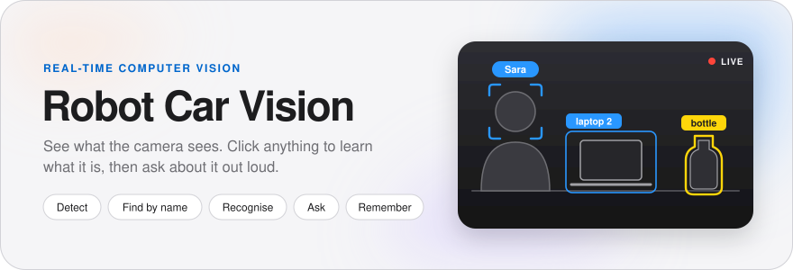
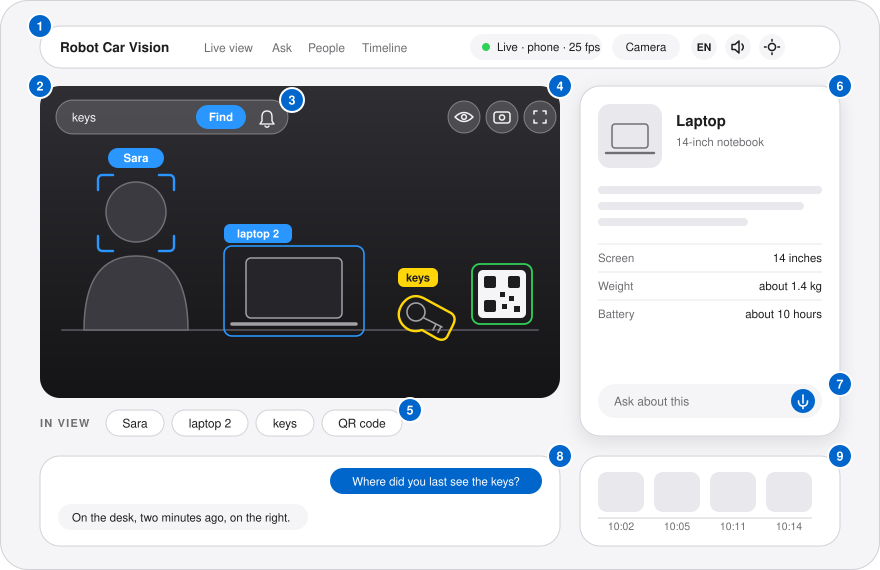
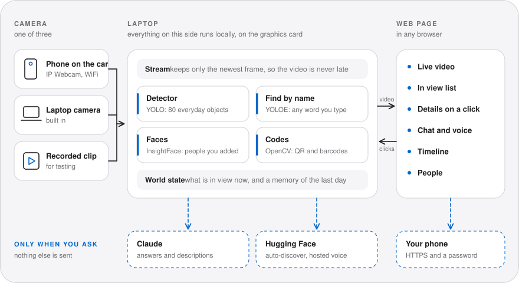

<p align="center">
  
</p>

<p align="center">
  
  
  
  
</p>

<p align="center">
  <a href="#what-it-does">What it does</a> ·
  <a href="#the-page">The page</a> ·
  <a href="#how-it-works">How it works</a> ·
  <a href="#quick-start">Quick start</a> ·
  <a href="#privacy">Privacy</a> ·
  <a href="#documentation">Documentation</a>
</p>

A camera streams to a laptop. The laptop finds and tracks objects, recognises the people you have added, and serves a web page with the live video. Click anything in the video to learn what it is, then ask about it, by typing or out loud.

The camera can be a phone riding on a small robot car, the laptop's own camera, or a recorded clip. The program only watches: nothing is sent to the car.

## What it does

| | |
| --- | --- |
| **Detect** | Labels and tracks 80 kinds of everyday object in live video, at up to about 25 frames a second on a GTX 1660 Ti. |
| **Find by name** | Type any word, like `keys` or `power bank`. What is found is drawn with its own outline, not a box. |
| **Recognise** | Greets the people you have added, by face. Adding a person takes five photos from the live camera. |
| **Explain** | Click an object: a panel says what it is, with a short description and its specifications. |
| **Ask** | A chat that answers from your own notes and from what the camera sees, in English or Arabic. |
| **Speak** | Ask into a microphone and hear the answer. The page never speaks by itself. |
| **Remember** | A timeline of what was seen and when: "Where did you last see the bottle?" |
| **Watch** | "Tell me when a bottle appears" shows a quiet notice when it does. |
| **Read** | QR codes and barcodes in view are marked and can be read with one click. |
| **Go mobile** | The page fits a phone, and opens on one over HTTPS behind a password. |

Each one is described in full in [docs/features.md](docs/features.md).

## The page

<p align="center">
  
</p>

| | Part | What it is for |
| --- | --- | --- |
| 1 | Top bar | Status, the camera's address, answer language, voice, light and dark. |
| 2 | Live video | Every found object has a label and a track number. Click one. |
| 3 | Look for | Find a thing by name, or press the bell to be told when it appears. |
| 4 | Video buttons | Describe the scene, turn the camera off and on, full screen. |
| 5 | In view | The same objects as a list, for when clicking the video is hard. |
| 6 | Details | What you clicked: a photo, a description and specifications. |
| 7 | Ask about this | More questions about that one thing. |
| 8 | Chat | Questions about your project, your team and what the camera saw. |
| 9 | Timeline | What was seen and when, with small pictures of objects, never of people. |

## How it works

<p align="center">
  
</p>

Each camera frame is read on the laptop. Hosted models are called only for something you ask for.

| Job | Model | Where it runs |
| --- | --- | --- |
| Everyday objects, tracked | YOLO (`yolo26n`) | Laptop, every frame |
| Things found by name | YOLOE (`yoloe-26s-seg`) | Laptop, only while you look for something |
| Faces of people you added | InsightFace | Laptop |
| QR codes and barcodes | OpenCV | Laptop, no model |
| Answers and descriptions | Claude | Anthropic API, on a click or a question |
| Auto-discover, hosted voice | Gemma, Kokoro, Whisper | Hugging Face, only with the switch on |

## Quick start

**Start it.** Double-click **Robot Car Vision** on the desktop, or run:

```powershell
.venv\Scripts\python.exe -m car_vision.app --open
```

A black window opens, the models load, and the page opens in the browser after about a minute. Closing the black window stops the program. The page starts with the laptop camera.

**Make the desktop shortcut** (once):

```powershell
powershell -NoProfile -ExecutionPolicy Bypass -File tools\make_shortcut.ps1
```

**Show it to people.** [RUNBOOK.md](RUNBOOK.md) is one page of what to show at a demo and what to do when something fails.

## Install

For Windows 11 with an NVIDIA graphics card.

1. Install Python 3.11 (64-bit) and Git.
2. Open PowerShell in the project folder and create the environment:

   ```powershell
   py -3.11 -m venv .venv
   ```

3. Install PyTorch with graphics-card support, then everything else:

   ```powershell
   .venv\Scripts\python.exe -m pip install torch==2.14.1 torchvision==0.29.1 --index-url https://download.pytorch.org/whl/cu130
   ```

   ```powershell
   .venv\Scripts\python.exe -m pip install -r requirements.txt
   ```

4. Repair ONNX Runtime. InsightFace installs a processor-only build over the graphics-card one, so remove both and put the right one back:

   ```powershell
   .venv\Scripts\python.exe -m pip uninstall -y onnxruntime onnxruntime-gpu
   ```

   ```powershell
   .venv\Scripts\python.exe -m pip install --no-deps onnxruntime-gpu==1.32.0
   ```

5. Check the laptop is ready:

   ```powershell
   .venv\Scripts\python.exe check_env.py
   ```

   Every line should start with `OK` or `NOTE`. A `FAIL` line says what to fix.

## What only you can provide

| What | How |
| --- | --- |
| **An API key** | Copy `.env.example` to `.env` and put your own Anthropic API key in it. A Hugging Face token (`HF_TOKEN`) is optional: it is for Auto-discover and the hosted voice. A page password (`PAGE_PASSWORD`) is optional: it is for opening the page on a phone. |
| **People** | Use the **People** section of the page, with each person's permission. By hand: a folder `data/people/<id>/` with 3 to 5 clear photos and an `about.md` (see `data/people.example/about.md`), then run the enroll command below. |
| **Notes** | Copy `data/knowledge.example.md` to `data/knowledge.md` and write what the assistant should know about your project and team. |
| **A sample clip** | About 2 minutes from the camera's height, saved as `data/samples/car_clip.mp4`, to test without a camera. |

Face photos, the saved face data, your notes and `.env` are never committed to Git.

## Use a phone

| To | Read |
| --- | --- |
| Use the phone as the camera (IP Webcam, same WiFi) | [The phone as the camera](docs/phone.md#the-phone-as-the-camera) |
| Open the page on the phone (HTTPS and a password) | [Open the page on your phone](docs/phone.md#open-the-page-on-your-phone) |

## Privacy

The video, the face photos, the face data, your notes and the memory stay on the laptop. Something leaves only when you do one of these:

| You do this | This is sent | To |
| --- | --- | --- |
| Click an object | A small cut-out of the picture, faces covered | Anthropic |
| Click a person | Nothing | |
| Ask a question | Your words, your notes, text lines from the memory | Anthropic |
| Press Describe | The whole picture | Anthropic |
| Switch Auto-discover on | A small picture every 10 seconds, up to a daily cost limit | Hugging Face |
| Switch the hosted voice or listening on | The answer's text, or your recorded question | Hugging Face |
| Use the browser's own voice or microphone | The answer's text, or the sound of your question | The browser's speech service |

A person is never treated as a thing: words for people are refused in Look for, a known name is answered by face recognition only, and the timeline keeps no picture of a person. The full list is in [docs/limits-and-privacy.md](docs/limits-and-privacy.md).

## Project layout

```text
car_vision/
  stream.py       live frames from the phone, the laptop camera or a clip
  detector.py     everyday objects and things found by name (the only module that imports ultralytics)
  recognizer.py   faces of the people you added (InsightFace)
  codes.py        QR codes and barcodes (OpenCV)
  pipeline.py     the loop: frames in, labelled pictures and a status out
  state.py        the one record shared by the vision side and the assistant side
  memory.py       what was seen and when (SQLite)
  assistant.py    questions and descriptions (the only module that imports anthropic)
  lookout.py      Auto-discover: a small hosted model names what is in view
  voice.py        the hosted voice and hosted listening
  door.py         the password-protected HTTPS door for a phone
  app.py          the web page and its API (the only module that imports flask)
  templates/      the page itself
config.yaml       every setting, with a comment beside each value
tests/            unit tests that need no camera, network or graphics card
specs/            why each part is built the way it is, milestone by milestone
```

Each part also runs by itself, which helps when something is wrong:

| Command | What you see |
| --- | --- |
| `.venv\Scripts\python.exe -m car_vision.stream` | The plain camera view with its FPS |
| `.venv\Scripts\python.exe -m car_vision.detector` | Objects labelled with boxes and track numbers |
| `.venv\Scripts\python.exe -m car_vision.enroll` | Turns the photos in `data/people/` into saved face data |
| `.venv\Scripts\python.exe -m car_vision.recognizer` | Names and info cards on the people it knows |
| `.venv\Scripts\python.exe -m car_vision.assistant` | A typed chat with the assistant |
| `.venv\Scripts\python.exe -m car_vision.app` | The full page in the browser (add `--open` to open it) |

Add `--source phone`, `--source webcam` or `--source file` to any camera command to pick the camera for that run. The default is `stream.source` in `config.yaml`.

## Tests

```powershell
.venv\Scripts\python.exe -m pytest
```

More than 3,000 tests. They run without a camera, the network or the graphics card.

## Documentation

| Page | What is in it |
| --- | --- |
| [docs/features.md](docs/features.md) | Every feature in detail |
| [docs/limits-and-privacy.md](docs/limits-and-privacy.md) | What the models cannot do, what is sent away, and the rules about people |
| [docs/phone.md](docs/phone.md) | The phone as the camera, and the page on a phone |
| [RUNBOOK.md](RUNBOOK.md) | One page for the day of a demo |
| [specs/](specs/) | The design of each milestone |

## Licence

This project is released under the GNU Affero General Public License v3.0; see [LICENSE](LICENSE). That matches the object detector it is built on: the YOLO weights and code from Ultralytics are AGPL-3.0.

The InsightFace pretrained face models are for non-commercial research only. That is fine for a university project; the face recognition part may not go into a commercial product as is.

Model weights, face photos, face data, recorded clips and the API key are not part of this repository. The models are downloaded on the first run; everything about people stays on the computer that runs the program.
